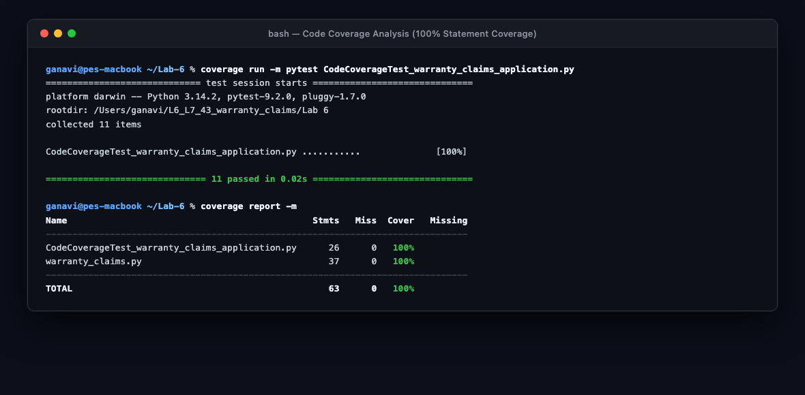
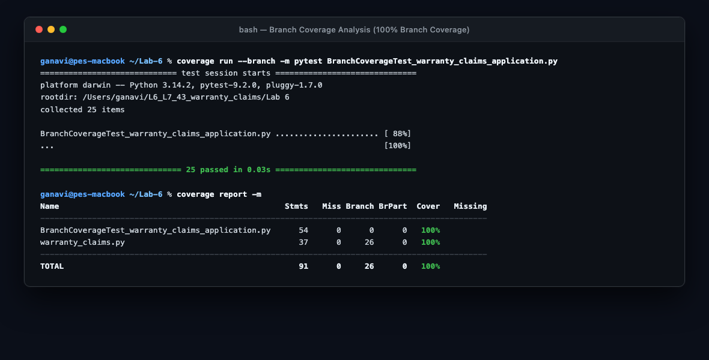
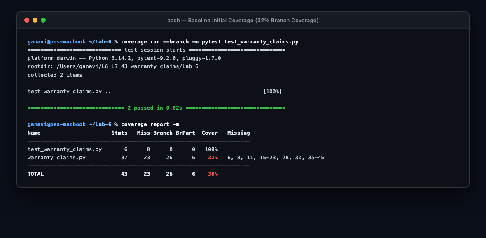

# Lab 6: Code and Branch Coverage Analysis

### PES University — Department of Computer Science & Engineering
**Course**: Software Engineering Lab  
**Lab Assignment 6**: Code and Branch Coverage Analysis  
**Problem Statement #43**: Warranty Claims (`L6_L7_43_warranty_claims`)  
**Student Name**: Ganavi Gowda  
**GitHub Account**: [ganavigowda8343-ctrl](https://github.com/ganavigowda8343-ctrl)  

---

## 1. Objective & Overview

This laboratory explores the critical differences between **statement (line) coverage** and **branch coverage** in software verification. While high line coverage confirms that instructions have executed at least once, branch coverage ensures every logical decision pathway evaluates to both `True` and `False`, uncovering hidden defects in boundary values, short-circuit logic, and compound boolean expressions.

### Application Under Test: `warranty_claims.py`
The module under test simulates warranty validation and SLA monitoring across three core routines:
1. `out_of_warranty_charge(plan, age_months, claim_type, is_registered)`: Computes repair charges based on plan tier (`basic`, `standard`, `premium`), product age, registration extensions, and defect vs accidental claim types.
2. `claim_allowed(days_since_last_claim, claims_filed, is_recall)`: Evaluates business rules regarding claim submission eligibility, recall exceptions, and anti-fraud rate limits.
3. `sla_status(hours_left, is_hardware, is_priority)`: Categorizes service ticket urgency into `on_track`, `at_risk`, or `critical` states based on category cutoffs and remaining turnaround hours.

---

## 2. Deliverables Summary

| Deliverable | File Path | Target Metric | Achieved Metric | Description |
| :--- | :--- | :--- | :--- | :--- |
| **Code Coverage Test Suite** | `CodeCoverageTest_warranty_claims_application.py` | $\ge 90\%$ Code Coverage | **100% (37/37 stmts)** | Targeted test cases exercising all functional statements. |
| **Branch Coverage Test Suite** | `BranchCoverageTest_warranty_claims_application.py` | $\ge 90\%$ Branch Coverage | **100% (26/26 branches)** | Targeted test cases covering all decision branches, compound conditions, and boundary edges. |
| **Unified Pytest Test File** | `test_warranty_claims.py` | $\ge 90\%$ Code & Branch | **100% / 100%** | Full standalone test suite executable directly via `pytest`. |
| **Code Coverage Screenshot** | `code_coverage_analysis.png` | Terminal Screenshot | Complete | High-resolution terminal capture of `coverage run` & `coverage report -m`. |
| **Branch Coverage Screenshot** | `branch_coverage_analysis.png` | Terminal Screenshot | Complete | High-resolution terminal capture of `coverage run --branch` & `coverage report -m`. |
| **Baseline Coverage Screenshot** | `initial_coverage_analysis.png` | Terminal Screenshot | Complete | Terminal capture of starter baseline test coverage (38% line / 32% branch). |

---

## 3. Coverage Analysis & Comparison

### 3.1. Quantitative Results Comparison

| Test Suite Phase | Statements (Total / Executed) | Line Coverage | Branches (Total / Partial / Missed) | Branch Coverage | Status |
| :--- | :---: | :---: | :---: | :---: | :---: |
| **Baseline Initial Test** | 37 / 14 | **38%** | 26 / 6 / 20 | **32%** | Untested paths (lines 6, 8, 11, 15-23, 28, 30, 35-45) |
| **Code Coverage Phase (Step 5)** | 37 / 37 | **100%** | 26 / 1 / 0 | **98%** | Missed branch `21->23` (accidental check inside excess > 12) |
| **Branch Coverage Phase (Step 7)** | 37 / 37 | **100%** | 26 / 0 / 0 | **100%** | **0 missed statements, 0 missed branches** |

### 3.2. Why Line Coverage $\ne$ Branch Coverage

The comparison between `CodeCoverageTest_warranty_claims_application.py` and `BranchCoverageTest_warranty_claims_application.py` proves that **100% line coverage does NOT imply 100% logical correctness**:
- In `warranty_claims.py`, line 21 states:
  ```python
  if excess > 12:
      rate = rate + 50
      if claim_type == "accidental":
          rate += 25
      return excess * rate
  ```
- When a test case runs with `excess = 16` and `claim_type = "accidental"`, lines 19, 20, 21, 22, and 23 all execute. Statement coverage reports **100%**.
- However, the decision `claim_type == "accidental"` evaluated only to `True`. The alternative pathway where `excess > 12` and `claim_type == "defect"` was never tested until the branch coverage suite added `test_out_of_warranty_unregistered_defect_excess_over_12()`.
- Similarly, compound condition `if is_registered and plan != "premium":` requires testing registered premium users to prove the second condition prevents unintended coverage extensions.

---

## 4. Verification Screenshots

### 4.1. Code Coverage Terminal Output (100% Statement Coverage)


### 4.2. Branch Coverage Terminal Output (100% Branch Coverage)


### 4.3. Baseline Initial Test Output (Before Improvement)


---

## 5. Test Suite Matrix

The complete test suite in `BranchCoverageTest_warranty_claims_application.py` contains 25 targeted unit tests:

### Function 1: `out_of_warranty_charge`
1. `test_out_of_warranty_unknown_plan`: Plan not in `COVERED_MONTHS` raises `ValueError("unknown plan")`.
2. `test_out_of_warranty_negative_age`: Negative age raises `ValueError("invalid age")`.
3. `test_out_of_warranty_registered_basic_within_coverage`: `is_registered=True` and `plan != "premium"` adds 6 months; age $\le$ covered returns `0`.
4. `test_out_of_warranty_registered_premium_does_not_extend`: Registered premium user does not receive additional extension.
5. `test_out_of_warranty_unregistered_defect_excess_over_12`: Excess $> 12$ with defect type applies $+50$ surcharge, testing false branch `21->23`.
6. `test_out_of_warranty_unregistered_accidental_excess_over_12`: Excess $> 12$ with accidental damage applies $+50 + 25$ surcharge.
7. `test_out_of_warranty_unregistered_defect_excess_under_12`: Excess $\le 12$ evaluates to base rate ($100$).
8. `test_out_of_warranty_exact_excess_12_boundary`: Boundary value `excess == 12` ensures strict inequality `excess > 12` evaluates to `False`.

### Function 2: `claim_allowed`
9. `test_claim_allowed_recall_within_limit`: Recall claim with `claims_filed = 5` evaluates to `True`.
10. `test_claim_allowed_recall_exceeds_limit`: Recall claim with `claims_filed = 6` evaluates to `False`.
11. `test_claim_allowed_days_less_than_30`: Regular claim with `days = 29` rejected due to cooldown period.
12. `test_claim_allowed_regular_boundary_days_within_claims`: Regular claim with `days = 30` and `claims = 2` allowed.
13. `test_claim_allowed_regular_exceeds_claims`: Regular claim with `days = 45` and `claims = 3` rejected.

### Function 3: `sla_status`
14. `test_sla_hardware_priority_on_track`: Hardware priority (cutoff = 72h) with 72h remaining $\rightarrow$ `on_track`.
15. `test_sla_hardware_priority_at_risk`: Hardware priority with 65h remaining $\rightarrow$ `at_risk`.
16. `test_sla_hardware_priority_critical`: Hardware priority with 50h remaining $\rightarrow$ `critical`.
17. `test_sla_hardware_non_priority_on_track`: Hardware non-priority (cutoff = 48h) with 50h remaining $\rightarrow$ `on_track`.
18. `test_sla_hardware_non_priority_at_risk`: Hardware non-priority boundary at 36h remaining $\rightarrow$ `at_risk`.
19. `test_sla_hardware_non_priority_critical`: Hardware non-priority with 35h remaining $\rightarrow$ `critical`.
20. `test_sla_software_priority_on_track`: Software priority (cutoff = 48h) with 48h remaining $\rightarrow$ `on_track`.
21. `test_sla_software_priority_at_risk`: Software priority with 40h remaining $\rightarrow$ `at_risk`.
22. `test_sla_software_priority_critical`: Software priority with 20h remaining $\rightarrow$ `critical`.
23. `test_sla_software_non_priority_on_track`: Software non-priority (cutoff = 24h) with 25h remaining $\rightarrow$ `on_track`.
24. `test_sla_software_non_priority_at_risk`: Software non-priority boundary at 12h remaining $\rightarrow$ `at_risk`.
25. `test_sla_software_non_priority_critical`: Software non-priority with 11h remaining $\rightarrow$ `critical`.

---

## 6. How to Reproduce

```bash
# 1. Install dependencies
pip install coverage pytest

# 2. Run Code Coverage test suite
coverage run -m pytest CodeCoverageTest_warranty_claims_application.py
coverage report -m

# 3. Run Branch Coverage test suite
coverage run --branch -m pytest BranchCoverageTest_warranty_claims_application.py
coverage report -m
```

---
*Created for PES University CSE Department — Software Engineering Lab (Lab 6).*
