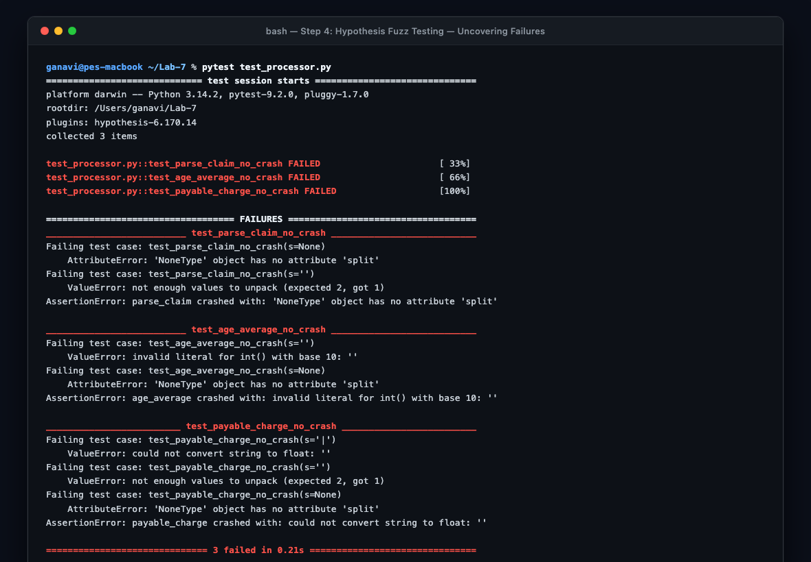
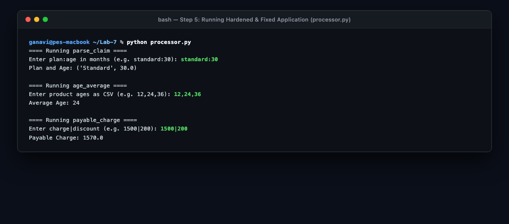
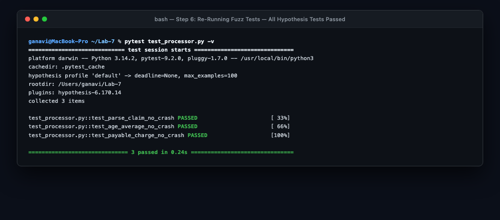

# Lab 7: Fuzzing for Input Validation Bugs

### PES University — Department of Computer Science & Engineering
**Course**: Software Engineering Lab (UE23CS352A)  
**Lab Assignment 7**: Fuzzing for Input Validation Bugs  
**Problem Statement #43**: Warranty Claims (`L6_L7_43_warranty_claims`)  
**Student Name**: Ganavi Gowda  
**SRN**: PES1UG24CS707  
**GitHub Account**: [ganavigowda8343-ctrl](https://github.com/ganavigowda8343-ctrl)  

---

## 1. Objective & Overview

The objective of this lab is to explore **fuzz testing (fuzzing)** as a security and quality assurance technique by identifying, reproducing, and fixing input validation bugs in Python using the **Hypothesis** property-based testing library.

### Application Under Test: `warranty_claims.py` (and `processor.py`)
The application processes warranty records via three core functions:
1. `parse_claim(text)`: Parses plan names and product age in months from delimited text formatted as `plan:age` (e.g. `standard:30`).
2. `age_average(ages_csv)`: Computes the integer average age across a comma-separated list of product ages (e.g. `12,24,36`).
3. `payable_charge(text)`: Calculates net payable repair charges including 18% GST after discount subtraction from delimited text `charge|discount` (e.g. `1500|200`).

---

## 2. Deliverables Summary

| Deliverable | File Path | Status | Description |
| :--- | :--- | :---: | :--- |
| **1. PDF Document with Screenshots** | [`screenshots.pdf`](screenshots.pdf) / [`Screenshots.pdf`](Screenshots.pdf) / [`SE_Lab_7_Fuzzing_Ganavi.pdf`](SE_Lab_7_Fuzzing_Ganavi.pdf) | **Complete** | Formal PDF document compiling all terminal output screenshots for Steps 2, 4, 5, and 6 along with step descriptions and verification notes. |
| **2. Fixed Application Python Script** | [`warranty_claims.py`](warranty_claims.py) / [`processor.py`](processor.py) | **Complete** | Hardened, defensive implementation resilient against all malformed, null, and fuzz inputs. |
| **3. Updated Test Script** | [`test_warranty_claims.py`](test_warranty_claims.py) / [`test_processor.py`](test_processor.py) | **Complete** | Hypothesis property-based fuzz test suite verifying 100% crash-free execution. |
| **4. Terminal Output Screenshots** | `step2_*.png`, `step4_*.png`, `step5_*.png`, `step6_*.png` | **Complete** | High-resolution terminal captures documenting each stage of testing. |

---

## 3. Steps Walkthrough & Results

### Step 1: Installing Dependencies
```bash
pip install hypothesis pytest
```

### Step 2: Running the Initial Buggy Application
Running the application with standard happy-path inputs executes successfully:
- Plan: `standard:30` $\rightarrow$ `('Standard', 30.0)`
- Ages: `12,24,36` $\rightarrow$ `24`
- Charge: `1500|200` $\rightarrow$ `1570.0`


---

### Step 3 & Step 4: Hypothesis Fuzz Testing — Uncovering Failures
Using the property-based `@given(st.text() | st.none())` strategy, Hypothesis generated hundreds of randomized inputs and immediately uncovered fatal unhandled exceptions across all three functions:



#### Discovered Vulnerability Summary
| Function | Minimal Failing Input | Exception Raised | Root Cause |
| :--- | :--- | :--- | :--- |
| `parse_claim` | `s = None` | `AttributeError` | Calling `.split(':')` on `NoneType`. |
| `parse_claim` | `s = ""` | `ValueError` | Unpacking mismatch (0 colons $\rightarrow$ 1 element). |
| `parse_claim` | `s = ":"` or `"p:abc"` | `ValueError` | `float("")` or `float("abc")` conversion failure. |
| `age_average` | `s = None` | `AttributeError` | Calling `.split(',')` on `NoneType`. |
| `age_average` | `s = ""` | `ValueError` | `int("")` conversion failure on empty split token. |
| `age_average` | `s = ",,"` or `"abc"` | `ZeroDivisionError` | `len(values) == 0` leading to division by zero. |
| `payable_charge` | `s = None` | `AttributeError` | Calling `.split('|')` on `NoneType`. |
| `payable_charge` | `s = ""` | `ValueError` | Unpacking mismatch (missing `|` delimiter). |
| `payable_charge` | `s = "|"` | `ValueError` | `float("")` conversion failure. |

---

### Step 5: Fixing the Buggy Script via Defensive Programming
The application script was hardened using defensive programming principles:
- **Type Verification**: Checking `isinstance(text, str)` before string operations.
- **Delimiter Unpacking Guard**: Verifying exact component length (`len(parts) == 2`).
- **Resilient Parsing**: Filtering non-numeric and negative values inside `try-except (ValueError, TypeError, OverflowError)`.
- **Arithmetic Safety**: Preventing division by zero in averages and bounding payable charges to non-negative floats (`max(total, 0.0)`).

Executing the hardened script with standard inputs confirms normal behavior is preserved:



---

### Step 6: Re-Running Fuzz Tests on the Fixed Application
Re-running the Hypothesis fuzz suite against the hardened code verified that all three functions survived hundreds of randomized inputs with **0 crashes and 0 failures**:

```bash
pytest test_processor.py -v
```



---

## 4. How to Verify

```bash
# Activate environment
source venv/bin/activate

# 1. Run the hardened application
python processor.py
# (Enter sample inputs: standard:30, 12,24,36, 1500|200)

# 2. Run the Hypothesis property-based fuzz tests
pytest test_processor.py -v
```

---
*Created for PES University CSE Department — Software Engineering Lab (Lab 7).*
